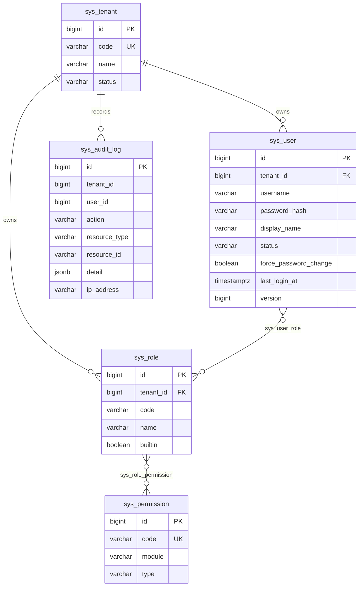
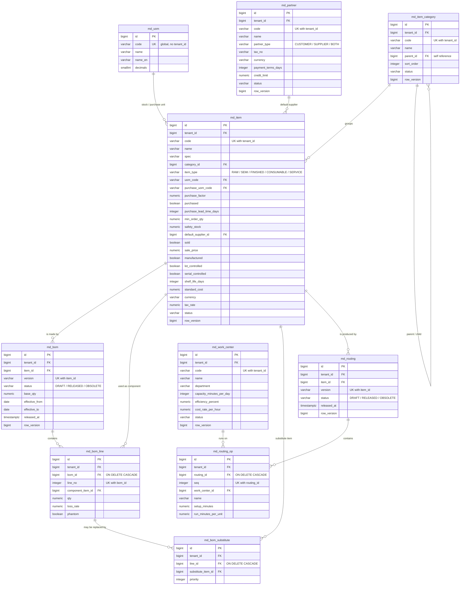
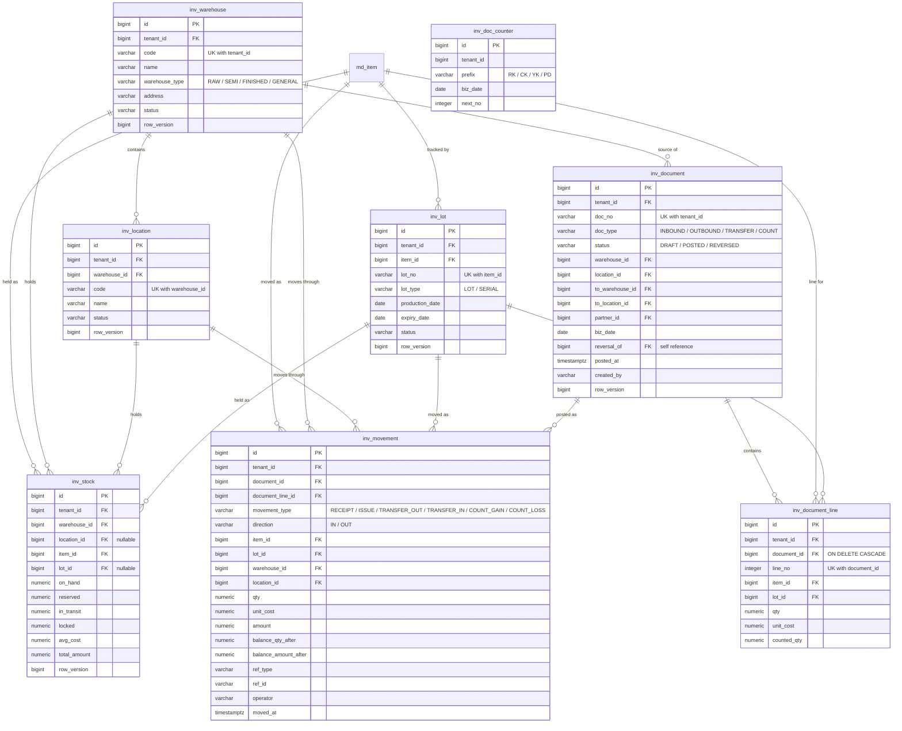
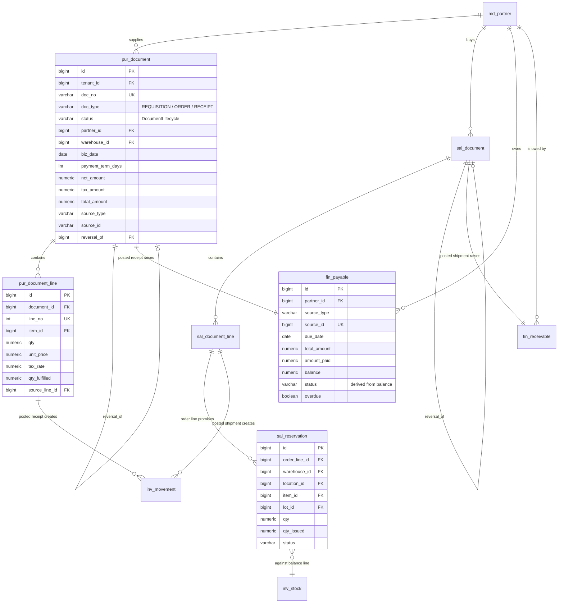
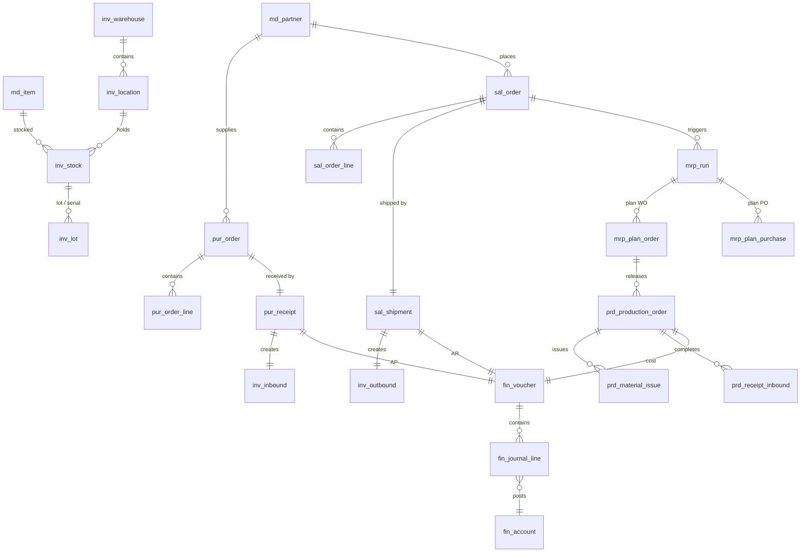

# 领域模型

表前缀约定：

| 前缀 | 领域 | 里程碑 |
|---|---|---|
| `sys_` | 系统（租户、用户、角色、权限、审计） | M0 ✅ |
| `md_` | 主数据（物料、客户、供应商、BOM、工艺、工作中心） | M1 ✅ |
| `inv_` | 库存（仓库、库位、批次、库存账、出入库单） | M2 ✅ |
| `pur_` | 采购（请购、采购订单、收料） | M3 ✅ |
| `sal_` | 销售（报价、销售订单、发货、占用） | M3 ✅ |
| `mrp_` | MRP（运算单、计划工单、计划采购单） | M4 |
| `prd_` | 生产订单（计划层，区别于 MES 的执行工单） | M4 |
| `fin_` | 财务（应收应付台账 M3，科目/凭证/总账 M5） | M3 ✅ / M5 |

通用列：`id BIGSERIAL`、`tenant_id BIGINT`（业务表）、`created_at` / `updated_at TIMESTAMPTZ`。金额与数量一律 `NUMERIC`，不用浮点。

## M0 已实现

要点：

- `sys_permission` 是**全局字典**，不带 `tenant_id`——权限码在所有工厂含义相同
- `sys_user_role` / `sys_role_permission` 是纯连接表，无额外列
- `sys_audit_log.tenant_id` 不设外键：审计必须能在租户重命名后存活，也不能级联删除

## M1 已实现

迁移脚本 `backend/masterdata/src/main/resources/db/migration/V3__masterdata.sql`，10 张表。

要点：

- 上图**不含** `created_at` / `updated_at`（见上文「通用列」）与纯描述性文本字段（`remark`、`short_name`、`contact_name`、`phone`、`email`、`address`）——这些字段不参与任何业务规则判断。**图中没有虚构列**，其余业务列与 `V3__masterdata.sql` 逐列一致
- **`md_uom` 是全局字典**，不带 `tenant_id`——`KG` 在每个工厂都指千克。M1 只暴露只读；自定义单位随 M2 的库存精度处理一起做，因为单位换算因子要先能配置才有意义
- **`row_version` 而非 `version`**：`md_bom` / `md_routing` 的 `version` 已经是工程版本号（`V1`/`V2`），乐观锁列再叫 `version` 就是同一个词在一张表里指两件事。所有可编辑表的乐观锁列统一叫 `row_version`
- **`md_partner` 单表**：同一家公司既可能是客户也可能是供应商，`partner_type` 用 `BOTH` 表达；按角色筛选时 `BOTH` 对两侧都可见
- **`md_item` 单表带 facet 布尔位**：把采购 / 销售 / 成本属性拆成三张从表，只会得到三张半满的表
- **`md_bom` 唯一键 `(tenant_id, item_id, version)`**，`version` 是**标签**（`V1`/`V2`/`2024-A`）不是递增数字；服务层保证同一物料最多一个 `RELEASED`
- **`md_bom_line` 只有 `loss_rate`**，没有单独的 `scrap_rate`——一个损耗率足够表达"多投一点料"，两个字段只会让人纠结该填哪个
- **`md_bom_substitute`** 独立表带 `priority`，因为替代料是"这条线位可以有 N 个备选"，塞进 `md_bom_line` 的 JSON 列就查不了
- 业务主键（`code`）在**服务层统一转大写**后再落库：PG 的唯一索引不是大小写不敏感的，靠 `upper()` 归一化比 `CITEXT` 扩展更容易迁移

### BOM 展开在哪算

当初计划用递归 CTE。实际实现放在**应用层**（`BomExplosion`），原因：

1. 展开要带**损耗率放大**与 `base_qty` 折算，还要支持 `maxLevels` 截断和环路标记——这些用递归 CTE 要拼很长的 SQL，而结果集本身是小型树
2. 同一份展开逻辑 M4 的 MRP 要复用（只换数据来源：BOM × 库存 × 在途），放 SQL 里就得复制一遍
3. 展开结果需要返回给前端做树形渲染，应用层对象本来就是目标形态

实现要点：只沿 `RELEASED` 边递归、`SCALE = 6` + `HALF_UP`、路径集合命中即标 `source = "CYCLE"`、`maxLevels` 夹在 1–20。

## M2 已实现

迁移脚本 `backend/inventory/src/main/resources/db/migration/V4__inventory.sql`，8 张表。

要点：

- **余额与流水分开**：`inv_stock` 回答「现在有多少」，就地改写；`inv_movement` 回答「怎么变成这样」，只追加。两者在同一个事务里改，因此永远不会不一致
- **`inv_stock` 的唯一键跨两个可空外键**（`location_id`、`lot_id`）：物料可以只记在仓库层、可以不带批次。PG 的唯一索引把 NULL 视为互不相同，所以索引用 `COALESCE(..., 0)` 折叠 —— 哨兵值 0 不会撞，因为 `BIGSERIAL` 从 1 开始
- **四个数量**：`on_hand` 是在库、`reserved` 是已被销售单占用、`locked` 是被质检或生产占用、`in_transit` 是在途。可用量 = `on_hand - reserved - locked`。M2 里 `reserved` / `locked` 恒为 0 —— 列先留着，因为 MRP 与销售马上要用，而一张装着活数据的余额表临时加列是要迁移的
- **批次与序列号同表**：`inv_lot.lot_type` 区分 `LOT` 与 `SERIAL`。序列号就是「只有一件的批次」，这样库存键、流水与追溯查询对两种情况是同一套逻辑，只有一个地方要查
- **单据只追加，不修改**：`DRAFT → POSTED → REVERSED`。冲销不是改原单据，而是生成一张红字单据在旁边，原单据留在账上 —— 审计要看到的是「错的那张」和「改的那张」，不是一个被抹平的空档
- **`inv_movement` 没有 `updated_at`**：流水一旦写下就不再变，冲销也是新增一条。它继承 platform 的 `TenantAppendOnlyEntity`，而不是 `TenantScopedEntity`
- **`inv_doc_counter` 是单号计数器**：单号形如 `RK-20261027-0001`（类型前缀 + 业务日期 + 当日流水号）。用 `INSERT ... ON CONFLICT DO UPDATE` 原子取号，而不是「数一数已有几张再 +1」—— 后者在两人同时保存时会发出重号
- 上图**不含** `created_at` / `updated_at` 与纯描述性文本字段（`remark`、`address`）

### 移动加权平均怎么算

规则只写一次，避免三个地方各算一遍：

1. **总额是权威值**，单位均价由它推导（`total ÷ qty`）
2. **入库**：`total += qty × 单价`，然后重算均价
3. **出库**：按当前均价计价，`total -= qty × 均价`
4. **清空**：数量归零时总额与均价一并归零，下一笔入库从头开始算，不继承旧均价

总额之所以是权威值：它只做加减，**精确累积**。若以均价为准，每一笔入库都要拿一个四舍五入过的均价去乘数量，误差会在几千笔流水里滚雪球。

**冲销不走"出库 + 入库"**：红字单据按原流水的**原值**逐笔反向调整。若改用今天的均价冲销，期间均价一旦变动就会留下残值，流水将不再等于余额。

### 库存计价

M2 采用**移动加权平均**：每次入库重算 `avg_cost = (旧金额 + 入库金额) / (旧数量 + 入库数量)`。FIFO 作为企业版可选。标准成本法依赖成本核算模块（企业版）。

## M3 已实现

**采购与销售是同一张信封的两面**，所以两侧共用同一套表结构：一条单据头 + 若干明细行，`doc_type` 决定这张单据是请购、订单还是收料。差别只在允许的状态迁移，由服务层而不是表结构来表达。

**链式引用靠 `source_line_id`**：订单行记住是哪一行请购行要的货，收料行记住它满足了哪一行订单。没有它，「为什么买了两百个」在数据库里没有答案。

**`sal_reservation` 记的是承诺，不是数量**：它记下**哪一行库存余额承诺给了哪一行订单**，而不只是一个数字。发货过账时先按余额行释放承诺、再出库——顺序反了，出库校验会看到"可用量不足"而拒绝这笔本该成功的发货。

**应收应付的唯一约束**：`UNIQUE (tenant_id, source_type, source_id)`。重复过账、双击提交、网络重试都不允许把一笔账记两遍。

### 金额为什么不进库存

收料按**不含税价**过账。进项税是可以抵扣的，把它摊进移动加权平均，之后每一次出库都会继承一个虚高的单价，`avg_cost` 与真实成本会越走越远。净额是会计要的，税额是税务要的，两者在单据行上同时落库、只算一次，不在出库时反推。

## M4–M5 规划（示意）

### 关键设计点

- **`mrp_run`**：快照式——记录运算参数与产出，便于复算对比；不覆盖历史
- **`prd_production_order`**：状态机 `PLANNED → RELEASED → IN_PROGRESS → COMPLETED → CLOSED`，`mes_wo_no` 关联 MES 执行工单
- **`fin_voucher`**：`source_type` + `source_id` 反查业务源头，保证「凭证可追溯回单据」

