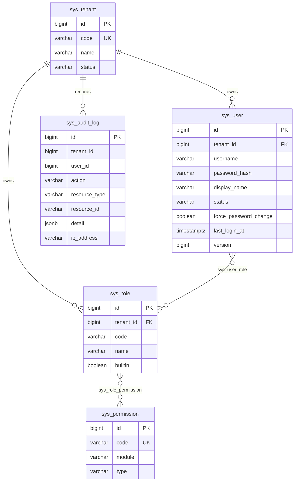
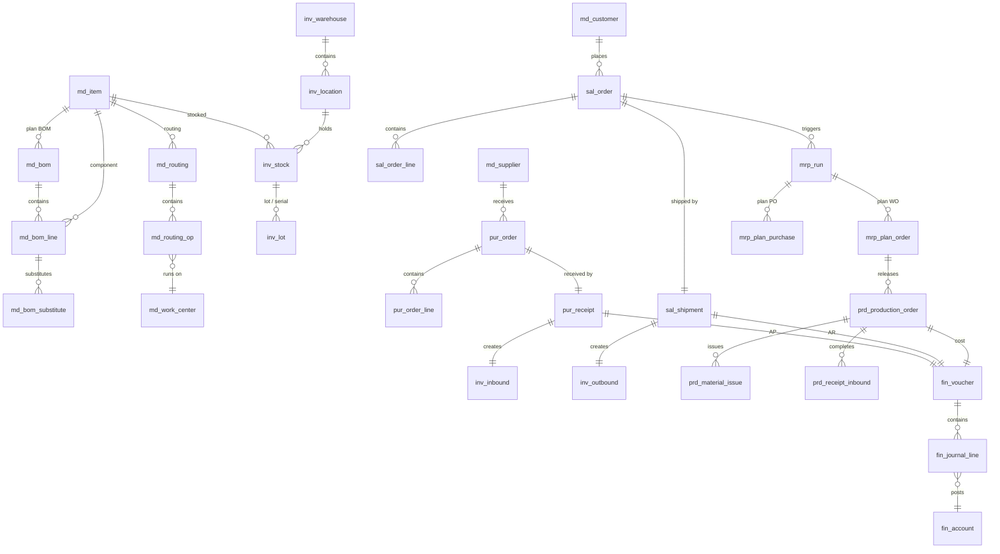

# 领域模型

表前缀约定：

| 前缀 | 领域 | 里程碑 |
|---|---|---|
| `sys_` | 系统（租户、用户、角色、权限、审计） | M0 ✅ |
| `md_` | 主数据（物料、客户、供应商、BOM、工艺、工作中心） | M1 |
| `inv_` | 库存（仓库、库位、批次、库存账、出入库单） | M2 |
| `pur_` | 采购（请购、采购订单、收料、应付） | M3 |
| `sal_` | 销售（报价、销售订单、发货、应收） | M3 |
| `mrp_` | MRP（运算单、计划工单、计划采购单） | M4 |
| `prd_` | 生产订单（计划层，区别于 MES 的执行工单） | M4 |
| `fin_` | 财务（科目、凭证、总账） | M5 |

通用列：`id BIGSERIAL`、`tenant_id BIGINT`（业务表）、`created_at` / `updated_at TIMESTAMPTZ`。金额与数量一律 `NUMERIC`，不用浮点。

## M0 已实现

要点：

- `sys_permission` 是**全局字典**，不带 `tenant_id`——权限码在所有工厂含义相同
- `sys_user_role` / `sys_role_permission` 是纯连接表，无额外列
- `sys_audit_log.tenant_id` 不设外键：审计必须能在租户重命名后存活，也不能级联删除

## M1–M5 规划（示意）

### 关键设计点

- **`md_bom` 多版本**：`(item_id, version)` 唯一，状态 `DRAFT / RELEASED / OBSOLETE`；只有 `RELEASED` 参与 MRP 展开
- **`md_bom_line`**：含 `qty`、`loss_rate`、`scrap_rate`、`is_phantom`（虚拟件）；替代料放独立表 `md_bom_substitute`，带优先级
- **`inv_stock`**：按 `(tenant_id, warehouse_id, location_id, item_id, lot_id, sn)` 唯一；数量拆成 `on_hand` / `reserved` / `in_transit` / `locked`，可用量 = `on_hand - reserved - locked`
- **`mrp_run`**：快照式——记录运算参数与产出，便于复算对比；不覆盖历史
- **`prd_production_order`**：状态机 `PLANNED → RELEASED → IN_PROGRESS → COMPLETED → CLOSED`，`mes_wo_no` 关联 MES 执行工单
- **`fin_voucher`**：`source_type` + `source_id` 反查业务源头，保证「凭证可追溯回单据」

### 库存计价

M2 采用**移动加权平均**：每次入库重算 `avg_cost = (旧金额 + 入库金额) / (旧数量 + 入库数量)`。FIFO 作为企业版可选。标准成本法依赖成本核算模块（企业版）。
